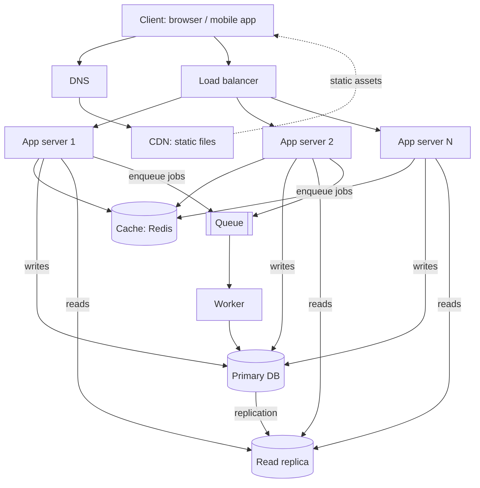

# QuickNotes Architecture

## Requirements

### Functional
- Users can register and log in.
- Users can create, read, update and delete notes.
- Users can tag notes and filter by tag.
- Users can list their notes with pagination.
- Optional background tasks: e.g. confirmation emails and search indexing.

### Non-functional
- **Availability:** 99.9% uptime; no single point of failure.
- **Latency:** list and read requests under 200 ms at the 95th percentile.
- **Scalability:** supports 1 million users and can grow horizontally.
- **Durability:** a saved note is never lost (replication and backups).
- **Security:** HTTPS everywhere, hashed passwords, per-user access control.
- **Consistency:** a user sees their own writes immediately; other views may be slightly stale.

## Load estimate (1 million users)

Assumptions:
- 1,000,000 registered users, 30% active daily = **300,000 daily active users (DAU)**
- Each active user reads notes 20 times/day and writes 2 times/day
- Peak traffic is 3x the average; 1 day = 86,400 seconds
- Average note = 1 KB (title, body, metadata)

| Metric | Calculation | Result |
|--------|-------------|--------|
| Reads per day | 300,000 x 20 | 6,000,000 |
| **Reads per second (avg)** | 6,000,000 / 86,400 | about 70 |
| Reads per second (peak) | 70 x 3 | about 210 |
| Writes per day | 300,000 x 2 | 600,000 |
| **Writes per second (avg)** | 600,000 / 86,400 | about 7 |
| Writes per second (peak) | 7 x 3 | about 21 |
| New notes per year | 600,000 x 365 | about 219 million |
| **Storage per year** | 219 million x 1 KB | about 219 GB (about 330 GB with indexes) |

Conclusion: the workload is read-heavy (about 10:1), which justifies a cache and read replicas. Write volume is small, so one primary database is enough at this scale.

## Architecture diagram



ASCII version:

```
Client -> DNS -> CDN (static files)
Client -> Load Balancer -> App Server 1 \
                        -> App Server 2  >-- Cache (Redis)
                        -> App Server N /--- Primary DB --replicates--> Read Replica
                                        \--- Queue -> Worker -> Primary DB
```

## Components: the problem each one solves

- **Client:** gives users an interface (web or mobile) to send requests to the API.
- **DNS:** translates the human-friendly name `quicknotes.com` into the IP address of our servers, and can route users to a healthy region.
- **CDN:** serves static files (HTML, CSS, JS, images) from locations near the user, reducing latency and taking load off our servers.
- **Load balancer:** spreads incoming requests across app servers and stops sending traffic to servers that fail health checks.
- **App servers (2 or more):** run the API logic; being stateless and duplicated means we can add more for capacity and survive one failing.
- **Cache (Redis):** keeps frequently read results in memory so most reads skip the slower database.
- **Primary database:** the single source of truth that accepts all writes, with data stored durably.
- **Read replica:** a live copy of the primary that serves read queries, offloading the primary and providing a backup that can be promoted if the primary fails.
- **Queue:** holds slow or non-urgent jobs so the API can respond immediately without waiting for them.
- **Worker:** picks jobs from the queue and runs them in the background (emails, search indexing), retrying if they fail.

## Request flows

### GET /notes
1. The client sends `GET /notes` with its auth token; DNS resolves the domain.
2. The load balancer picks a healthy app server.
3. The app server validates the token and identifies the user.
4. It checks the cache for key `notes:user:{id}:page:1`.
5. **Cache hit:** return the cached JSON immediately (go to step 8).
6. **Cache miss:** query the **read replica** for the user's notes.
7. Store the result in the cache with a short TTL (for example 60 seconds).
8. Return `200 OK` with the JSON list.

### POST /notes
1. The client sends `POST /notes` with JSON and its token.
2. The load balancer routes it to an app server.
3. The app server authenticates the user and **validates** the input (title required, at most 100 characters); invalid input returns `400`.
4. It writes the note (and tags) to the **primary database** in a transaction.
5. It **invalidates** the user's cached note-list keys so the next read is fresh.
6. It publishes a job to the **queue** (for example "index note" or "send email").
7. It returns `201 Created` with the new note and a `Location` header.
8. A **worker** consumes the job later and processes it in the background.

## Trade-offs

1. **Cache: speed vs freshness.** Caching makes reads much faster and cheaper, but data can be stale for up to the TTL. We reduce this by invalidating the cache on every write and keeping TTLs short.
2. **Read replica: scale vs consistency.** Replication is asynchronous, so a replica may lag by milliseconds and a user could briefly not see a note they just created. We accept this for most reads and route "read your own write" requests to the primary.
3. **SQL primary: simplicity vs write scaling.** One primary is simple and consistent, but all writes go through it. This is fine at about 21 writes/second; if it grows, we can shard by `user_id`.
4. **Queue: responsiveness vs complexity.** Background jobs keep the API fast, but add a component to run and mean results (like emails) are eventually, not instantly, delivered.

## Avoiding single points of failure

- **DNS and CDN:** managed services with many servers worldwide.
- **Load balancer:** run as a redundant pair (active/passive or managed multi-zone).
- **App servers:** several stateless instances across availability zones; if one dies, the load balancer routes around it.
- **Cache:** Redis with a replica and automatic failover. If the cache is lost, the system still works by reading from the database, only slower.
- **Database:** the read replica can be promoted to primary on failure; automated backups and point-in-time recovery protect data.
- **Queue and workers:** a replicated/managed queue keeps messages durable; multiple workers mean jobs continue if one worker fails.ls